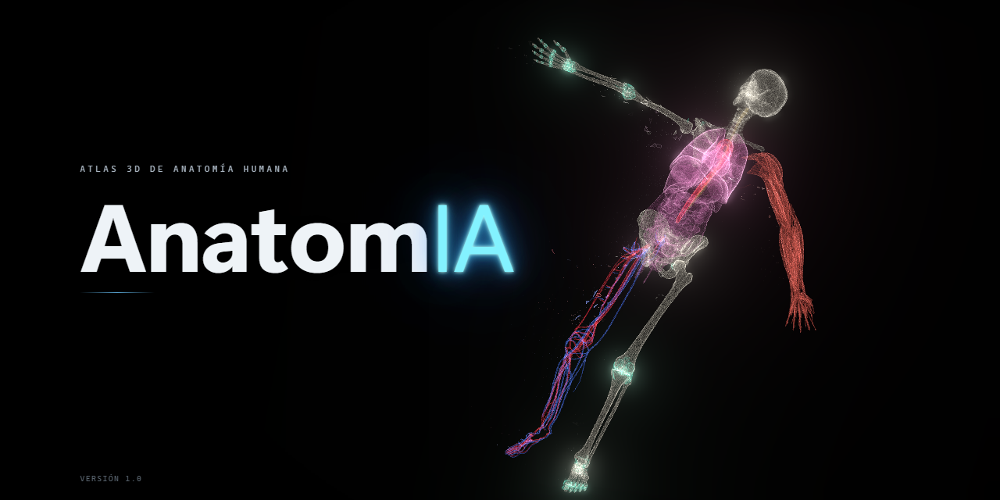
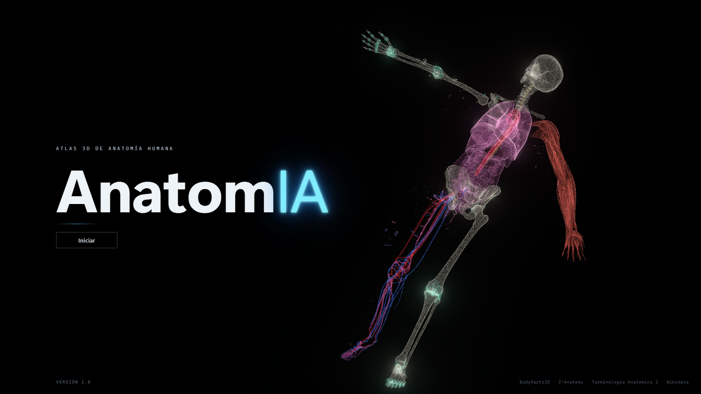
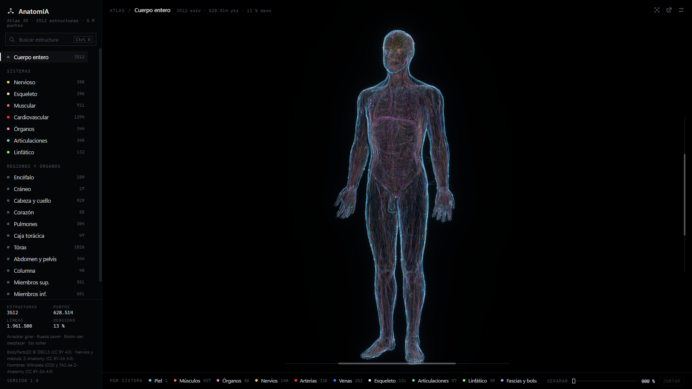
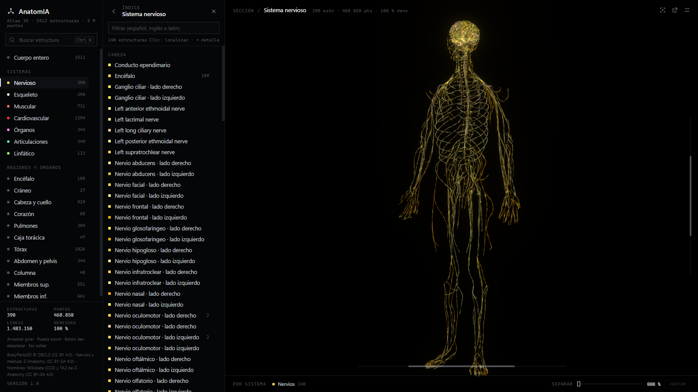
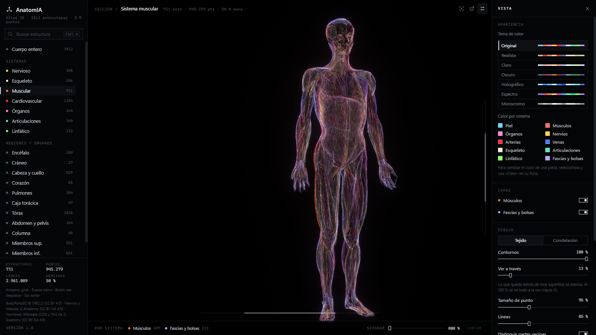
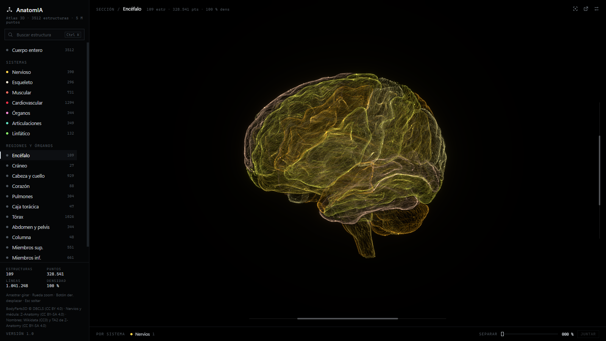
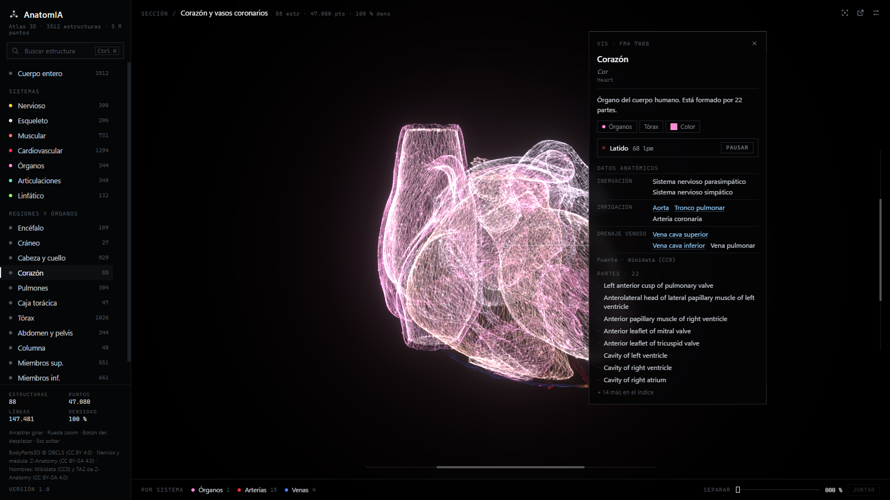
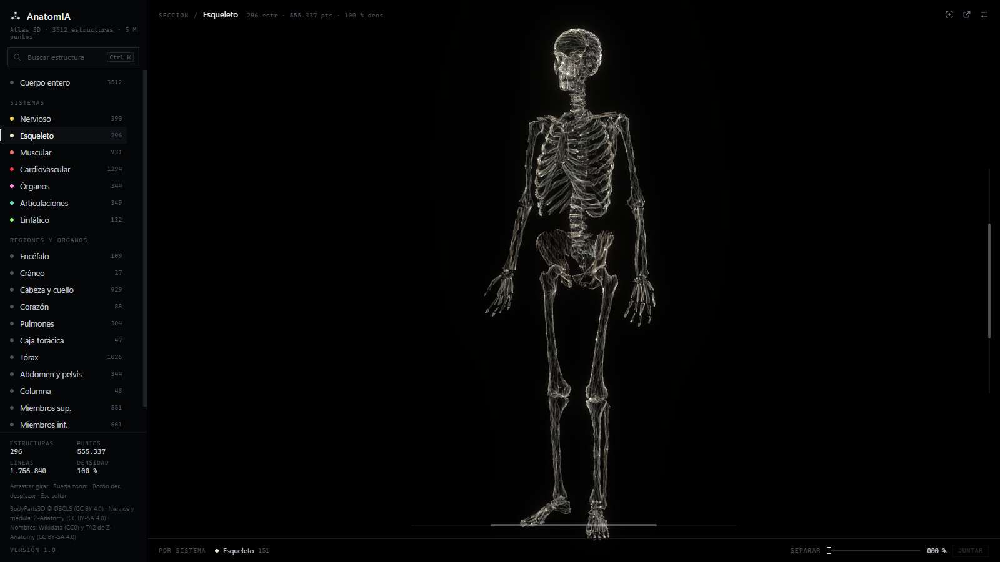
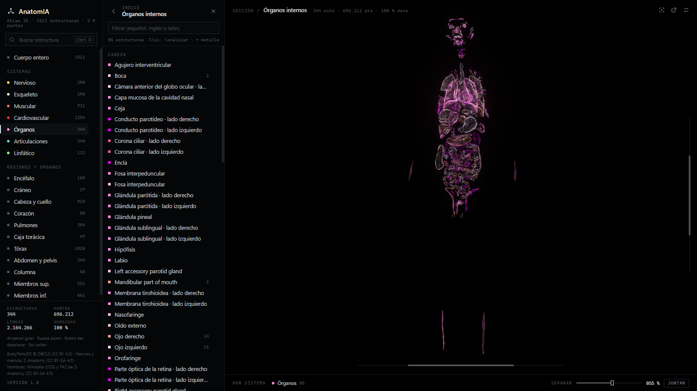

<p align="center">
  
</p>

<h1 align="center">
  <br>
  AnatomIA
</h1>

<p align="center">
  <strong>Atlas 3D de anatomía humana para estudiantes, en español.</strong><br>
  Más de 3.500 estructuras del cuerpo dibujadas como un tejido de puntos y fibras luminosas, con
  nombres, descripciones y relaciones anatómicas.
</p>

<p align="center">
  Windows 10 / 11 · Versión 1.0 · Español
</p>

---

## Qué es

AnatomIA es una aplicación de escritorio para estudiar anatomía en 3D. Reúne en un solo atlas el
cuerpo completo de un varón adulto —huesos, músculos, órganos, nervios, vasos, articulaciones,
ligamentos, fascias y ganglios linfáticos— y lo muestra con un estilo técnico y limpio: cada pieza
es una nube de puntos unidos por fibras finas, con los contornos resaltados para que la forma se
lea bien incluso cuando hay muchas estructuras superpuestas.

Se puede recorrer el cuerpo entero, un sistema, una región o un órgano concreto, ver cada pieza por
separado y consultar su ficha con los datos anatómicos más importantes.

## Qué ofrece

- **3.512 estructuras** de BodyParts3D y Z-Anatomy: esqueleto, músculos, órganos, sistema nervioso
  central y periférico, arterias y venas, articulaciones y ligamentos (cápsulas, discos, meniscos),
  fascias, bolsas y vainas, y ganglios linfáticos.
- **Nombres en español** (y en latín e inglés) para la mayoría de las piezas.
- **Vistas por sistema** (nervioso, esqueleto, muscular, cardiovascular, órganos, articulaciones,
  linfático) y **por región u órgano** (encéfalo, cráneo, cabeza y cuello, corazón, pulmones, caja
  torácica, tórax, abdomen y pelvis, columna, miembros superiores e inferiores).
- **Órganos completos**: al pasar el ratón se señala el órgano entero (todo el intestino delgado,
  el encéfalo, el pulmón derecho…) y al pinchar se abre solo él, con todas sus partes; el resto del
  cuerpo se desvanece poco a poco para ver dónde está.
- **Ficha de cada estructura**: nombre en español, latín e inglés, descripción, sistema y región, y
  datos anatómicos de Wikidata (origen, inserción, acción, inervación, irrigación, drenaje, ramas)
  enlazados con las piezas del atlas.
- **Índice y búsqueda**: el índice de cada vista se filtra en español, inglés o latín; la búsqueda
  global (Ctrl+K) encuentra cualquier estructura y vuela hasta ella.
- **Herramientas de estudio**: separar las partes (vista explosionada), lupa que pela capas al
  acercarse (piel → músculo → órganos → esqueleto), «ver a través» de las superficies, contornos,
  capas por sistema y barras para desplazarse por el modelo.
- **Corazón y pulmones en movimiento**: al seleccionarlos, el corazón late y los pulmones respiran.
- **Apariencia a medida**: siete temas de color, color por sistema o por pieza, estilo «Tejido» o
  «Constelación», tamaño de punto, líneas y giro automático.
- **Detalle por zoom**: cuanto más se acerca la cámara, más puntos y fibras se dibujan; cada vista
  puede abrirse en otra ventana.
- **Funciona sin conexión**: todo el atlas va dentro de la aplicación.

## Capturas

| | |
|:---:|:---:|
|  |  |
| Pantalla de inicio | Cuerpo entero |
|  |  |
| Sistema nervioso con su índice | Sistema muscular y ajustes de la vista |
|  |  |
| Encéfalo | Corazón con su ficha (y latido) |
|  |  |
| Esqueleto | Órganos internos separados |

## Descargar e instalar

1. Descarga `AnatomIA-1.0-Instalador.exe` desde [Releases](../../releases/latest).
2. Ábrelo y sigue el asistente. Se instala para tu usuario, sin permisos de administrador (también
   se puede instalar para todos los usuarios).
3. Abre **AnatomIA** desde el menú Inicio o el acceso directo del escritorio.

**Requisitos**: Windows 10 u 11 de 64 bits, tarjeta gráfica con WebGL 2 y unos 500 MB libres. La
aplicación se abre en calidad «Baja», fluida también con gráficas integradas; la calidad «Alta» se
elige en *Vista › Rendimiento*.

## Uso

| Acción | Cómo |
|---|---|
| Girar | Arrastrar con el botón izquierdo |
| Acercar o alejar | Rueda del ratón |
| Desplazar | Botón derecho, o las barras de abajo y de la derecha |
| Ver una estructura | Pasar el ratón; clic para abrirla con todas sus partes |
| Buscar | Ctrl+K |
| Soltar la selección | Esc |
| Ajustes de la vista | Icono de ajustes, arriba a la derecha |

## Desarrollo

Hecho con **Electron**, **React**, **Three.js** (WebGL 2, shaders propios y bloom), **Zustand** y
**MiniSearch**. Los datos se generan con un pipeline en **Python** (numpy, scipy) que convierte las
mallas de BodyParts3D y Z-Anatomy en nubes de puntos con niveles de detalle.

```bash
npm install                # dependencias
npm run dev                # abrir en modo desarrollo
npm run build:installer    # instalador de Windows (requiere Inno Setup 6)
```

El atlas (`resources/anatomy/`) no está en el repositorio: se genera con el pipeline de
`pipeline/`. Los pasos, la estructura del código y los detalles técnicos están en
[docs/DESARROLLO.md](docs/DESARROLLO.md).

## Créditos y licencias de los datos

- **BodyParts3D**, © The Database Center for Life Science (DBCLS), licencia
  [CC BY 4.0](https://creativecommons.org/licenses/by/4.0/).
  <https://dbarchive.biosciencedbc.jp/en/bodyparts3d/>
- **Z-Anatomy**, The libre 3D atlas of anatomy, licencia
  [CC BY-SA 4.0](https://creativecommons.org/licenses/by-sa/4.0/): sistema nervioso periférico y
  médula, articulaciones y ligamentos, fascias y bolsas, ganglios linfáticos y otras piezas.
  Incluye material de «Cranial Nerves and Foramina», University of Dundee, CAHID (CC BY 4.0).
  <https://github.com/Z-Anatomy/Models-of-human-anatomy>
- **Terminologia Anatomica 2** (traducción al español de Z-Anatomy), CC BY-SA 4.0: nombres.
- **Wikidata**: nombres en español y latín, descripciones y relaciones anatómicas
  ([CC0](https://creativecommons.org/publicdomain/zero/1.0/)).

Los datos anatómicos que genera el pipeline son una obra derivada de los anteriores y se
distribuyen con licencia **CC BY-SA 4.0**. El código de la aplicación es independiente de los datos.

> AnatomIA es una herramienta de estudio: no sustituye a los textos de referencia ni al consejo
> médico.
